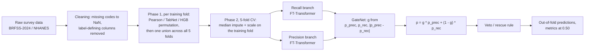

# HeartSense: dual-branch FT-Transformer for heart-disease risk prediction (research code and verified reproduction)

This package contains the original research implementation behind

> **Leakage-Safe Precision-Aware Dual-Branch FT-Transformer for Population-Scale Heart Disease Risk Prediction.**
> J. Islam et al., *Sensors* **2026**, 26(11), 3417. https://doi.org/10.3390/s26113417

It also contains the evidence from a complete re-run of that code on 5–6 November 2026. The re-run reproduced every
trained model's out-of-fold predictions **bit for bit** against the outputs saved in the original project.

> **Private review copy.** It is not licensed for redistribution, and ownership and co-author permissions have not yet been reviewed. The raw datasets are not included.

## Start here: suggested reading order

| # | File | Why |
| --- | --- | --- |
| 1 | `CODE_WALKTHROUGH.md` | A guided tour of the implementation, with function names and line numbers: preprocessing, feature selection, the dual-branch FT-Transformer, recall- and precision-biased training, GateNet and veto/rescue, baselines, and how the reproduction was verified |
| 2 | `original_code/brfss2024_phase2_run_fttransformer_dualbranch_precbiased_gate.py` | The proposed model. Key lines: 203–285 (architecture), 300–310 (precision loss), 399–483 (GateNet), 485 (`train_one_branch`), 582–627 (gate inference, veto/rescue), 739–860 (cross-validation loop), 1032–1058 (ablation) |
| 3 | `original_code/brfss2024_phase1_feature_fusion_cache_builder.py` | Feature selection per training fold, then a union across all folds (see §2 for what this means for fold independence). Key lines: 114, 131, 193 (the three selectors), 264 (fusion), 369–468 (fold loop and union) |
| 4 | `original_code/brfss2024_phase2_all_models_allfeatures_master.py` | The 11-model baseline benchmark. Key lines: 217–347 (classical models, including the skipped XGBoost/CatBoost wrappers), 450 (deep-model trainer), 612 (model registry), 727–972 (CV loop and master table) |
| 5 | `REPRODUCIBILITY.md` | What was re-run, what matched, and where published values differ from the saved outputs |
| 6 | `evidence/package_build/verification.md` | Checks that the packaged code is the original code, apart from paths |

The NHANES versions of scripts 2–3 (`original_code/nhanes_*`) follow the same structure. `docs/METHOD.md` gives the full method description, and `CONTRIBUTION.md` the contribution map and attribution notes.

**Contents**
- [1. What is in this package](#1-what-is-in-this-package)
- [2. The method in brief](#2-the-method-in-brief)
- [3. Experiments and evaluation](#3-experiments-and-evaluation)
- [4. Verified results](#4-verified-results)
- [5. How to run](#5-how-to-run)
- [6. Layout](#6-layout)
- [7. Reproducibility evidence](#7-reproducibility-evidence)
- [8. Attribution](#8-attribution)

## 1. What is in this package

| Folder / file | What it is |
| --- | --- |
| `original_code/` | The **19 original research scripts** (6,951 lines) that produced the paper's main results. They are distribution copies: identical to the originals except that the personal Windows user folder in hard-coded default paths reads `C:\Users\<user>\` (see `PACKAGE_NOTES.md`) |
| `run_code/` | Execution copies of the 14 scripts whose file paths are written into the code. They differ from `original_code/` **only in path strings**, and `tools/make_run_copies.py` regenerates them for wherever this folder is placed |
| `CODE_WALKTHROUGH.md` | Guided tour of the code with function and line references (start here) |
| `docs/METHOD.md` | Code-level description of the pipeline, with file and line references |
| `DATA.md` | Exact dataset sources, file names, sizes and SHA-256 checksums, and where to put the files |
| `env/` | `requirements.txt` (47 package versions captured from the project's `.venv312` during the reproduction; not a record of the January 2026 environment) and `ENVIRONMENT.md` (the hardware and software used) |
| `verified_outputs/` | Outputs of the verified re-run: feature lists, metrics, confusion matrices, ablations, master table and figures (about 2 MB). Row-level prediction files are listed by checksum only |
| `REPRODUCIBILITY.md` | The reproduction result (Stages 0–4) and a comparison of published numbers with the saved outputs |
| `CONTRIBUTION.md` | Contribution map: which files show which part of the work, with attribution notes |
| `evidence/` | Stage reports, file-by-file comparison reports, run logs, environment records, SHA-256 manifests, and the exact tool versions used for the verified runs |
| `tools/`, `00*.ps1`–`04*.ps1` | Non-scientific helpers: environment check, run-copy generation, stage runner with pre-flight checks and logging, output comparison, package verification |

## 2. The method in brief

The task is binary classification of self-reported coronary heart disease or myocardial infarction (BRFSS-2024
`_MICHD`), with an external check on NHANES 2017–March 2020. The positive class is about 9.4% of BRFSS respondents and 9.5% of the NHANES cohort.



- **Phase 1: feature selection per training fold, then combined across folds.**
  - In each of five stratified folds (seed 42), three selectors run on the training part only:
    - absolute Pearson correlation ≥ 0.08;
    - TabNet mask importance ≥ 0.75 / N;
    - HistGradientBoosting permutation importance, with a conservative lower bound μ − 1.7σ > 2×10⁻⁴ (5 repeats on a 30,000-row stratified subsample).
  - A fold keeps every feature any selector chose. The final list is the union over the folds: 181 of 283 numeric BRFSS features, and 141 of 163 NHANES features. Phase 2 uses this one list in every fold.
  - Selection happens inside each training fold, but the five fold selections are then combined into one shared union. Every respondent is in the training part of four of the five Phase-1 folds, so the shared list used in each Phase-2 outer fold was chosen partly with that fold's validation data. The complete procedure therefore does not maintain strict outer-fold-independent feature selection.
- **Phase 2: two FT-Transformers trained for different errors.**
  - **Architecture:** each numeric feature becomes a 48-dimensional token (a learned per-feature weight and bias). Tokens pass through 2 pre-norm transformer blocks (4 attention heads, GELU feed-forward ×4, dropout 0.08), are mean-pooled, and go through an MLP head (256 → 64 → 1).
  - **Two separately trained branches:**
    - The *recall branch* uses class-weighted BCE (pos_weight = negatives/positives).
    - The *precision branch* divides that weight by α = 1.3 and multiplies the loss of negative samples by 4, which makes false positives costlier.
  - **Training:** AdamW (lr 3×10⁻⁴, weight decay 10⁻⁵), batch 1,024, at most 30 epochs, early stopping on inner-validation AUPRC with patience 6, mixed precision, fixed seeds and deterministic cuDNN.
- **GateNet: per-person mixing.**
  - A 3→16→1 MLP reads (p_prec, p_rec, |p_prec − p_rec|).
  - It is trained on the inner validation split to predict when the precision branch is right and the recall branch is wrong.
  - At inference a bias of 0.9 is added to its logit, and its output g mixes the branches: p = g·p_prec + (1 − g)·p_rec.
- **Veto/rescue rule:**
  - If p_prec < 0.20 the final probability is set to 0.
  - If p_rec > 0.98 it is set to 1.
  - Decisions use threshold 0.50.
  - In the verified runs the veto applied to 72–85% of samples per fold and rescue never fired. On NHANES the final and gate-only 0.50 decisions are identical (FP 679, FN 374 in both). On BRFSS they differ by one false positive: 50,488 for gate-only versus 50,487 for the final output, with FN 16,975 in both.
- **Leakage controls in the code:**
  - label-defining columns are removed (`CVDINFR4`, `CVDCRHD4` for BRFSS; `MCQ160B/C/D/E` for NHANES);
  - imputation and scaling are fitted on training folds only;
  - early stopping and GateNet training use an inner split of the training fold;
  - SMOTE for the LightGBM baseline is applied to training folds only.
  - Not covered by these controls: the Phase-1 feature list is a union across all five folds and is shared by every Phase-2 fold (see Phase 1 above).

`docs/METHOD.md` gives the same description with references to the functions and lines in `original_code/`.

## 3. Experiments and evaluation

| Experiment | Scripts (`original_code/`) | Paper element |
| --- | --- | --- |
| NHANES cohort build: merge 18 modules on SEQN, drop variables > 70% missing, build `CVD_TARGET` | `nhanes_merge_check.py`, `nhanes_cleaning_step1.py`, `nhanes_create_target.py` | Table 14 |
| NHANES Phase 1 + proposed model + ablation | `nhanes_phase1_feature_fusion_cache_builder.py`, `nhanes_phase2_run_fttransformer_dualbranch_precbiased_gate.py` | Tables 14–15 |
| NHANES baselines (LightGBM, Random Forest, CNN) + Fig 15 | `nhanes_baseline_comparison_models.py`, `nhanes_confusion_matrix_comparison_plot.py` | Table 15, Fig 15 |
| BRFSS Phase 1 + dataset summary | `brfss2024_phase1_feature_fusion_cache_builder.py`, `generate_dataset_summary.py` | Table 3 |
| BRFSS proposed model + ablation | `brfss2024_phase2_run_fttransformer_dualbranch_precbiased_gate.py` | Tables 8–10, abstract |
| 11 BRFSS baselines on all 283 numeric features | `brfss2024_phase2_all_models_allfeatures_master.py`, `update_master_table_add_experiment.py`, `artifacts/…/plot_grouped_metrics.py` | Tables 4, 6, Fig 4 |
| Error, threshold, rule-sensitivity and calibration analyses | `simple_Avarage_fusion.py`, `confusion_metrix_allmodel.py`, `FP/FN_bar_chart.py` (Fig 5; run as `run_code/FN_bar_chart.py`), `plot_threshold_curve.py`, `heatmap.py`, `plot_calibration_brier_ece.py` | Tables 8–9, 12; Figs 5, 7–11 |

- **Evaluation:**
  - All models use stratified 5-fold cross-validation with shuffling and seed 42.
  - The scripts report accuracy, balanced accuracy, precision, recall, F1, ROC-AUC and AUPRC (scikit-learn average precision) per fold and as fold means.
  - Pooled out-of-fold confusion matrices are given at threshold 0.50.
  - Threshold curves cover 0.01–0.99. The veto/rescue sensitivity grid is v = 0.10–0.30, r = 0.90–0.99.
  - Calibration is measured with Brier score and 15-bin ECE for raw, Platt and isotonic calibration, cross-fitted over 5 folds.
- **Baselines** (BRFSS, all 283 numeric features):
  - LightGBM (SMOTE inside training folds);
  - logistic regression, linear SVM (calibrated), decision tree and random forest (class-balanced);
  - KNN, Gaussian naive Bayes;
  - an autoencoder + logistic regression;
  - a 1-D CNN, an LSTM and a GRU.

  XGBoost and CatBoost were not installed in the original environment, so the script skipped them, and they are not installed here.

## 4. Verified results

These values are the outputs of the verified re-run, which are bit-identical to the original saved outputs.

**BRFSS-2024, 5-fold mean at threshold 0.50** (`verified_outputs/brfss/phase2_allmodels_allfeatures/master_results_phase2_allfeatures.csv`)

| Model | Accuracy | Balanced acc. | Precision | Recall | F1 | ROC-AUC | PR-AUC |
| --- | --- | --- | --- | --- | --- | --- | --- |
| **Proposed (dual-branch FT-Transformer)** | 0.8509 | 0.7380 | 0.3359 | 0.5991 | **0.4294** | 0.8030 | 0.3659 |
| Random Forest | 0.8517 | 0.7284 | 0.3318 | 0.5768 | 0.4212 | 0.8494 | 0.3730 |
| Logistic regression | 0.7522 | 0.7706 | 0.2453 | 0.7933 | 0.3747 | 0.8491 | 0.3799 |
| LSTM | 0.7567 | 0.7580 | 0.2491 | 0.7597 | 0.3722 | 0.8420 | 0.3606 |
| 1-D CNN | 0.7418 | 0.7727 | 0.2400 | 0.8108 | 0.3703 | 0.8505 | 0.3808 |
| GRU | 0.7281 | 0.7591 | 0.2287 | 0.7973 | 0.3550 | 0.8373 | 0.3487 |
| Autoencoder + LR | 0.7378 | 0.7360 | 0.2245 | 0.7337 | 0.3438 | 0.8087 | 0.2903 |
| Decision tree | 0.7459 | 0.7064 | 0.2170 | 0.6577 | 0.3263 | 0.7600 | 0.2637 |
| Naive Bayes | 0.6550 | 0.7188 | 0.1862 | 0.7973 | 0.3019 | 0.7555 | 0.1925 |
| LightGBM | 0.9089 | 0.5603 | 0.5572 | 0.1313 | 0.2126 | 0.8526 | 0.3831 |
| Linear SVM | 0.9091 | 0.5528 | 0.5745 | 0.1144 | 0.1902 | 0.8483 | 0.3784 |
| KNN | 0.9067 | 0.5042 | 0.6147 | 0.0090 | 0.0178 | 0.7774 | 0.2802 |

**Proposed model on BRFSS**, pooled out-of-fold over 452,464 respondents: TN 359,639 · FP 50,487 · FN 16,975 · TP 25,363 (F1 0.4292).

The ablation, pooled F1:

| Variant | Pooled F1 |
| --- | --- |
| Recall branch only | 0.3781 |
| Precision branch only | 0.3750 |
| Simple branch average | 0.4310 |
| GateNet only, no veto/rescue (FP 50,488) | 0.4292 |
| GateNet + veto/rescue, final (FP 50,487) | 0.4292 |

**NHANES 2017–March 2020** (9,180 participants, 141 features). Proposed model pooled: TN 7,626 · FP 679 · FN 374 · TP 501, F1 0.4876. AUROC/AUPRC are 0.8062/0.4252 for the final output and 0.8736/0.4677 for the gate-only output.

**Published values that differ from the saved outputs.** Ten of the 200 published values checked differ from the original saved outputs, including the Table 6 proposed-model row and Table 15 AUROC/AUPRC. The reproduction equals the saved outputs in every case. The full list is in `REPRODUCIBILITY.md` §5; it is recorded as found and the paper is not corrected here.

## 5. How to run

The verified runs used Windows 11, Python 3.12.10, PyTorch 2.9.1 + CUDA 12.8 and an NVIDIA RTX 5070 Ti Laptop GPU (12 GB); see `env/ENVIRONMENT.md`. The scripts use the GPU when PyTorch finds one; running on CPU was not tested. On a different GPU, driver or library build, results may differ in the last digits.

1. **Get the data:** follow `DATA.md`.
   - Put `main_data_brfss_2024.XPT` in `data/brfss/` and the 18 NHANES `P_*.xpt` files in `data/nhanes/`.
   - Alternatively set `HS_BRFSS_XPT` to the BRFSS file's location.
2. **Create the environment and the run copies** (PowerShell, from this folder):
   ```powershell
   powershell -ExecutionPolicy Bypass -File .\00_setup_env.ps1      # .venv with the versions captured from .venv312; generates run_code\ for this folder
   powershell -ExecutionPolicy Bypass -File .\00a_gpu_check.ps1     # optional: records GPU / driver / CUDA
   ```
   On Linux or macOS:
   ```bash
   python3.12 -m venv .venv && . .venv/bin/activate
   pip install -r env/requirements.txt --extra-index-url https://download.pytorch.org/whl/cu128
   python tools/check_env.py && python tools/make_run_copies.py --overwrite && python tools/verify_package.py
   ```
3. **Run the stages in order.** Each stage runs a pre-flight check first, asks for `YES`, logs everything to `logs/`, and then compares the new outputs with `verified_outputs/` (`reports/compare_stageN_*.md`) and with the published numbers (`reports/published_vs_reproduced_*.csv`).

   | Stage | Command (Windows) | Time on the verified GPU |
   | --- | --- | --- |
   | 1 NHANES | `.\01_stage1_nhanes.ps1` | 3 min |
   | 2 BRFSS Phase 1 + proposed model | `.\02_stage2_brfss_core.ps1` | 185 min |
   | 3 BRFSS baselines | `.\03_stage3_brfss_baselines.ps1` | 72 min |
   | 4 BRFSS analyses (no training) | `.\04_stage4_brfss_analysis.ps1` | < 1 min |

   - Add `-CheckOnly` to any stage script to run the pre-flight only.
   - Without PowerShell, run `python tools/run_stage.py --stage N`, then `python tools/compare_outputs.py --stage N`.
4. **Row-level prediction files.** These are not shipped (116 MB). Stages 2 and 3 regenerate them, and `python tools/verify_package.py --check_excluded` compares them by SHA-256 with the verified run (`manifests/excluded_files.sha256`).

## 6. Layout

```
├── README.md  CODE_WALKTHROUGH.md  REPRODUCIBILITY.md  CONTRIBUTION.md  DATA.md  PACKAGE_NOTES.md
├── original_code/        19 original scripts (distribution copies)
├── run_code/             14 path-only execution copies (+ _generated_for.json)
├── PATH_CHANGES.diff     the 27 path lines changed for the verified runs
├── docs/METHOD.md
├── env/                  requirements.txt, ENVIRONMENT.md
├── data/                 (empty) place the datasets here, see DATA.md
├── runs/  logs/  reports/   (empty) new runs write here
├── verified_outputs/     outputs of the verified November 2026 run
├── evidence/             reports, logs, manifests and tools of the verified runs; package build checks
├── manifests/            package checksums, distribution hashes, excluded-file hashes, sanitisation map
├── tools/                runner, comparison, environment and package checks
└── 00_setup_env.ps1  00a_gpu_check.ps1  01…04 stage scripts
```

## 7. Reproducibility evidence

- `evidence/reports/FINAL_REPRODUCIBILITY_REPORT.md` and `STAGE0`–`STAGE4` reports.
- Comparison reports: `compare_stage*.md`, file by file against the original saved outputs.
- `published_vs_reproduced_20261106_031053.csv`: 200 published values checked.
- `evidence/logs/`: for every step, the command, working folder, start/end time, exit code, console output and environment snapshot.
- `evidence/manifests_verified_runs/`: SHA-256 manifests of every output, of the copies made from the original project, and of the 277-file original-project baseline (unchanged after every stage).
- `evidence/package_build/`: the checks run when this package was built.
  - The distribution copies differ from the originals only in the user-folder path, with matching Python syntax trees after normalisation of the permitted path-string literals.
  - The execution copies differ only in path strings, with matching Python syntax trees after normalisation of the permitted path-string literals.
  - Regenerating the execution copies for the original folder reproduces the 14 files used in the verified runs byte for byte.

## 8. Attribution

The research code in `original_code/` comes from the author's project folder, and it produced the results reported in the paper. The November 2026 reproduction automation, comparison tools, documentation and packaging were prepared with AI assistance (Claude, Anthropic) under the author's direction. The author ran every training stage on the author's own computer and reviewed each stage before the next began. See `CONTRIBUTION.md` for the contribution map and for points marked for the author's review.
