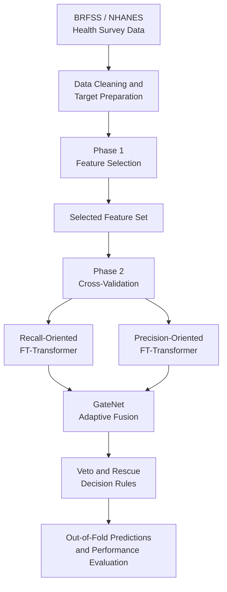

# Dual-Branch FT-Transformer
### Original Research Implementation and Reproducibility

This repository contains the original research implementation, experimental results, and supporting computational materials for the peer-reviewed study:

> **Leakage-Safe Precision-Aware Dual-Branch FT-Transformer for Population-Scale Heart Disease Risk Prediction**
>
> **Authors:** Jahidul Islam, Dristi Datta, and Fowzia Akhter
>
> **Published in:** *Sensors*, 2026, 26(11), 3417
>
> **DOI:** https://doi.org/10.3390/s26113417

## Research Overview

Heart disease remains a major public-health challenge, and identifying individuals at elevated risk is particularly difficult when population-scale health datasets exhibit substantial class imbalance.

This research investigates a **precision-aware Dual-Branch FT-Transformer** for heart-disease risk prediction using large-scale, structured health-survey data.

The proposed method combines two complementary learning objectives:

- A **recall-oriented branch** designed to improve identification of individuals in the positive class.
- A **precision-oriented branch** designed to reduce false-positive predictions.

Their outputs are integrated through a learned **GateNet fusion mechanism**, followed by decision-level veto and rescue rules.

The approach was experimentally evaluated using **BRFSS 2024** and a separate **NHANES 2017–March 2020** cohort-specific evaluation pipeline, alongside classical machine-learning, ensemble-learning, and deep-learning baselines.

This repository provides direct access to the original Python research implementation, feature-selection procedures, training and evaluation workflows, baseline comparisons, experimental outputs, and supporting documentation.

### Original Research and Repository Preparation

The research implementation and its experimental results were developed during the original study.

The original Python scripts are preserved in `original_code/`. Supporting execution copies provide environment-specific path adjustments while retaining the original computational logic.

In November 2026, these existing research materials were organised into a structured repository and the core computational experiments were rerun to verify their reproducibility.

The verification reproduced the original saved feature selections, model predictions, baseline results, confusion matrices, and other available experimental outputs.

Detailed verification evidence is provided in `REPRODUCIBILITY.md`.

**Project naming:** The research was initially developed under the working name *HeartSense*. This repository uses **Dual-Branch FT-Transformer** as the short name of the published method. Historical folder names and paths remain unchanged to preserve the original research records.

---

## Repository Navigation

For academic and technical review, the following reading order is recommended.

| Order | File | Description |
| --- | --- | --- |
| 1 | [`CODE_WALKTHROUGH.md`](CODE_WALKTHROUGH.md) | Technical walkthrough of the original implementation, including model components, functions, execution flow, and relevant code locations. |
| 2 | `original_code/brfss2024_phase2_run_fttransformer_dualbranch_precbiased_gate.py` | Main BRFSS implementation of the Dual-Branch FT-Transformer, GateNet, training, evaluation, and ablations. |
| 3 | `original_code/brfss2024_phase1_feature_fusion_cache_builder.py` | Original feature-selection implementation. |
| 4 | `original_code/brfss2024_phase2_all_models_allfeatures_master.py` | Baseline model implementations and comparative evaluation. |
| 5 | [`docs/METHOD.md`](docs/METHOD.md) | Detailed explanation of the computational methodology. |
| 6 | [`REPRODUCIBILITY.md`](REPRODUCIBILITY.md) | Experimental verification, reproducibility evidence, and numerical comparisons. |
| 7 | [`CONTRIBUTION.md`](CONTRIBUTION.md) | Research contributions, implementation history, academic supervision, and attribution. |

The corresponding NHANES implementations are available in `original_code/nhanes_*`.

### Repository Contents

| Directory / File | Contents |
| --- | --- |
| `original_code/` | 19 original research Python scripts implementing the principal computational workflow. |
| `run_code/` | 14 path-adjusted execution copies of existing research scripts, prepared for reproducibility verification. |
| `verified_outputs/` | Verified experimental outputs, metrics, feature-selection results, model comparisons, ablations, and figures. |
| `docs/METHOD.md` | Computational methodology and implementation details. |
| `CODE_WALKTHROUGH.md` | Code-level explanations with function and line references. |
| `DATA.md` | Dataset sources, expected files, preparation steps, and integrity information. |
| `REPRODUCIBILITY.md` | Verification procedures, experimental comparisons, and supporting evidence. |
| `CONTRIBUTION.md` | Research contributions and implementation attribution. |
| `env/` | Dependency specifications and execution-environment documentation. |
| `evidence/` | Execution logs, stage reports, source manifests, comparison records, and provenance evidence. |
| `manifests/` | Package checksums, source-file mappings, and excluded-file records. |
| `tools/` | Environment inspection, execution, output comparison, and integrity-verification utilities. |

---

## 1. Research Methodology

### 1.1 Research Datasets

Two population-scale health datasets were used in the research.

| Dataset | Participants | Positive-Class Prevalence | Selected Features |
| --- | ---: | ---: | ---: |
| BRFSS 2024 | 452,464 | Approximately 9.36% | 181 |
| NHANES 2017–March 2020 | 9,180 | Approximately 9.53% | 141 |

**BRFSS 2024** is the primary development and benchmarking dataset. The binary target is based on the self-reported coronary heart disease or myocardial infarction indicator (`_MICHD`).

**NHANES 2017–March 2020** provides an independent cohort-specific evaluation of the proposed modelling approach.

The NHANES pipeline includes separate preprocessing, feature selection, model training, and evaluation. It does not represent direct deployment of BRFSS-trained weights to NHANES participants.

Dataset preparation and target construction are described in [`DATA.md`](DATA.md).

### 1.2 Overall Computational Workflow



The research workflow consists of feature selection, complementary branch training, adaptive probability fusion, decision refinement, and comparative evaluation.

### 1.3 Phase 1: Feature Selection

The feature-selection strategy combines three methods:

**1. Pearson correlation**

Features are selected using an absolute correlation threshold of 0.08.

**2. TabNet feature importance**

TabNet mask importance is evaluated using the threshold:

`0.75 / N`

where `N` represents the number of candidate features.

**3. HistGradientBoosting permutation importance**

Permutation importance is evaluated using the lower-confidence-bound criterion:

`μ − 1.7σ > 2 × 10⁻⁴`

The procedure uses five permutation repeats on a stratified 30,000-row subsample.

The three selectors are applied within Phase-1 training folds, and their selected features are combined.

The selections from the five Phase-1 folds are subsequently united into one shared feature set for Phase 2.

This produces:

- **181 selected BRFSS features** from 283 numeric features.
- **141 selected NHANES features** from 163 candidate features.

**Methodological detail:** The shared Phase-2 feature set is constructed using a union of selections across all Phase-1 folds. Although the selectors operate within individual Phase-1 training folds, the resulting shared feature set is not strictly independent of every Phase-2 outer validation fold.

The exact procedure is documented in [`docs/METHOD.md`](docs/METHOD.md) and [`CODE_WALKTHROUGH.md`](CODE_WALKTHROUGH.md).

### 1.4 Phase 2: Dual-Branch FT-Transformer

The proposed architecture employs two separately trained FT-Transformer branches.

#### Transformer Architecture

Each numeric feature is converted into a learned 48-dimensional token.

The architecture includes:

- Two pre-normalisation Transformer blocks.
- Four attention heads.
- GELU feed-forward layers with a fourfold expansion.
- Dropout of 0.08.
- Mean pooling over feature-token representations.
- An MLP prediction head with dimensions 256 → 64 → 1.

#### Recall-Oriented Branch

The recall-oriented branch uses class-weighted binary cross-entropy:

`pos_weight = number of negative samples / number of positive samples`

This objective emphasises positive-class detection.

#### Precision-Oriented Branch

The precision-oriented branch modifies the class-loss weighting to place greater emphasis on controlling false-positive predictions.

The implementation uses:

- Positive-class weighting adjustment: `α = 1.3`
- Negative-sample loss multiplier: `4`

Both branches use the same overall FT-Transformer architecture with different training objectives.

#### Training Configuration

| Parameter | Value |
| --- | --- |
| Optimiser | AdamW |
| Learning rate | `3 × 10⁻⁴` |
| Weight decay | `10⁻⁵` |
| Batch size | 1,024 |
| Maximum epochs | 30 |
| Early-stopping metric | Inner-validation AUPRC |
| Early-stopping patience | 6 |
| Precision | Mixed-precision training |
| Evaluation | Stratified five-fold cross-validation |

The implementation includes fixed random seeds and deterministic cuDNN settings.

### 1.5 GateNet: Adaptive Probability Fusion

GateNet combines the predictions of the two FT-Transformer branches.

It is implemented as a multilayer perceptron with dimensions:

`3 → 16 → 1`

The three inputs are:

1. Precision-branch probability: `p_prec`
2. Recall-branch probability: `p_rec`
3. Absolute prediction disagreement: `|p_prec − p_rec|`

GateNet learns from inner-validation data to identify circumstances in which the precision-oriented branch predicts correctly while the recall-oriented branch does not.

The inference process applies a logit bias of 0.9.

The resulting fusion is:

\[
p = g p_{\mathrm{prec}} + (1-g)p_{\mathrm{rec}}
\]

where `g` is the GateNet output.

### 1.6 Veto and Rescue Decision Rules

The final prediction procedure applies the following rules:

- **Veto:** If `p_prec < 0.20`, the final probability is set to 0.
- **Rescue:** If `p_rec > 0.98`, the final probability is set to 1.

Final binary predictions are evaluated at a threshold of 0.50.

The verified results show that the rescue rule was not triggered in the completed runs. The gate-only and final predictions differed by one false positive on BRFSS and produced identical thresholded decisions on NHANES.

### 1.7 Preprocessing and Evaluation Controls

The implementation includes:

- Removal of label-defining columns:
  - BRFSS: `CVDINFR4`, `CVDCRHD4`
  - NHANES: `MCQ160B`, `MCQ160C`, `MCQ160D`, `MCQ160E`
- Median imputation fitted on training folds.
- Feature scaling fitted on training folds.
- Inner-validation splits for early stopping and GateNet training.
- Training-fold-only SMOTE for the applicable LightGBM baseline.

The shared Phase-1 feature-selection union is described in Section 1.3.

---

## 2. Experimental Design

### 2.1 Cross-Validation and Performance Metrics

The original implementation uses stratified five-fold cross-validation with shuffling and seed 42.

The evaluated metrics include:

- Accuracy
- Balanced accuracy
- Precision
- Recall
- F1-score
- ROC-AUC
- Average precision (AUPRC / PR-AUC)

Both fold-level and aggregated performance results are recorded.

Pooled out-of-fold confusion matrices are calculated at threshold 0.50.

The supporting analyses include threshold sensitivity, false-positive and false-negative analysis, calibration, and selected model ablations.

### 2.2 Baseline Models

The BRFSS experimental benchmark includes **11 executed baseline models**:

| Category | Models |
| --- | --- |
| Linear models | Logistic regression, calibrated linear SVM |
| Tree-based models | Decision tree, random forest, LightGBM |
| Instance-based and probabilistic models | KNN, Gaussian naive Bayes |
| Representation-learning baseline | Autoencoder with logistic regression |
| Deep-learning models | 1-D CNN, LSTM, GRU |

The BRFSS baseline evaluation uses all 283 numeric features.

The original benchmark script also contains XGBoost and CatBoost wrappers. Those models were not executed in the original baseline run.

The NHANES evaluation includes LightGBM, Random Forest, and CNN baselines.

---

## 3. Experimental Results

This section presents the saved computational outputs reproduced during the November 2026 verification.

### 3.1 BRFSS 2024: Model Comparison

**Dataset:** 452,464 respondents

**Evaluation:** Stratified five-fold cross-validation

**Source:**

`verified_outputs/brfss/phase2_allmodels_allfeatures/master_results_phase2_allfeatures.csv`

| Model | Accuracy | Balanced Accuracy | Precision | Recall | F1 | ROC-AUC | AUPRC |
| --- | ---: | ---: | ---: | ---: | ---: | ---: | ---: |
| **Dual-Branch FT-Transformer** | 0.8509 | 0.7380 | 0.3359 | 0.5991 | **0.4294** | 0.8030 | 0.3659 |
| Random Forest | 0.8517 | 0.7284 | 0.3318 | 0.5768 | 0.4212 | 0.8494 | 0.3730 |
| Logistic Regression | 0.7522 | 0.7706 | 0.2453 | 0.7933 | 0.3747 | 0.8491 | 0.3799 |
| LSTM | 0.7567 | 0.7580 | 0.2491 | 0.7597 | 0.3722 | 0.8420 | 0.3606 |
| 1-D CNN | 0.7418 | 0.7727 | 0.2400 | 0.8108 | 0.3703 | 0.8505 | 0.3808 |
| GRU | 0.7281 | 0.7591 | 0.2287 | 0.7973 | 0.3550 | 0.8373 | 0.3487 |
| Autoencoder + LR | 0.7378 | 0.7360 | 0.2245 | 0.7337 | 0.3438 | 0.8087 | 0.2903 |
| Decision Tree | 0.7459 | 0.7064 | 0.2170 | 0.6577 | 0.3263 | 0.7600 | 0.2637 |
| Naive Bayes | 0.6550 | 0.7188 | 0.1862 | 0.7973 | 0.3019 | 0.7555 | 0.1925 |
| LightGBM | 0.9089 | 0.5603 | 0.5572 | 0.1313 | 0.2126 | 0.8526 | 0.3831 |
| Linear SVM | 0.9091 | 0.5528 | 0.5745 | 0.1144 | 0.1902 | 0.8483 | 0.3784 |
| KNN | 0.9067 | 0.5042 | 0.6147 | 0.0090 | 0.0178 | 0.7774 | 0.2802 |

The proposed Dual-Branch FT-Transformer achieved the highest five-fold mean F1-score among the 11 executed baseline models at the specified decision threshold.

Other models achieved higher performance on some individual metrics, including ROC-AUC and AUPRC.

### 3.2 BRFSS: Pooled Out-of-Fold Predictions

The pooled confusion matrix for the proposed model is:

| Metric | Count |
| --- | ---: |
| True Negatives (TN) | 359,639 |
| False Positives (FP) | 50,487 |
| False Negatives (FN) | 16,975 |
| True Positives (TP) | 25,363 |

**Pooled F1-score: 0.4292**

The pooled F1-score and the five-fold mean F1-score are reported separately because they use different aggregation methods.

### 3.3 BRFSS: Model Ablation

The original experimental workflow evaluates the contributions of the individual branches and fusion mechanisms.

| Configuration | Pooled F1 |
| --- | ---: |
| Recall branch only | 0.3781 |
| Precision branch only | 0.3750 |
| Simple branch average | 0.4310 |
| GateNet without veto/rescue | 0.4292 |
| GateNet with veto/rescue | 0.4292 |

These results provide a direct comparison of the alternative branch-combination strategies.

The simple-average configuration achieved a slightly higher pooled F1-score than the final GateNet configuration in this ablation. The final veto/rescue rules changed one BRFSS false-positive decision at threshold 0.50.

### 3.4 NHANES: Independent Cohort-Specific Evaluation

The NHANES evaluation used:

- **9,180 participants**
- **141 selected features**
- A separate cohort-specific model-training and evaluation pipeline.

The proposed model produced the following pooled out-of-fold confusion matrix:

| Metric | Count |
| --- | ---: |
| True Negatives (TN) | 7,626 |
| False Positives (FP) | 679 |
| False Negatives (FN) | 374 |
| True Positives (TP) | 501 |

**Pooled F1-score: 0.4876**

The corresponding probability-ranking results were:

| Output Configuration | AUROC | AUPRC |
| --- | ---: | ---: |
| Gate-only | 0.8736 | 0.4677 |
| Final veto/rescue output | 0.8062 | 0.4252 |

The gate-only and final configurations produced identical binary decisions at threshold 0.50, although their probability-ranking metrics differed.

### 3.5 Experimental Results and Reproducibility

The original research scripts were rerun in November 2026 and compared with the experimental outputs saved in the research project.

Core outputs—including feature selections, model predictions, confusion matrices, baseline evaluations, and other available analyses—were reproduced, with exact matches for many files.

The verification also compared 200 numerical values from the published manuscript with the archived research outputs. Ten comparisons identified differences between the printed values and the saved computational results.

These comparisons are documented in [`REPRODUCIBILITY.md`](REPRODUCIBILITY.md), particularly Section 5.

The original research code and experimental outputs were preserved throughout verification.

---

## 4. Reproducing the Research Experiments

The repository provides execution scripts, environment documentation, dataset instructions, and verified outputs to support independent computational inspection.

### 4.1 Verified Execution Environment

The November 2026 verification was completed using:

| Component | Configuration |
| --- | --- |
| Operating system | Windows 11 |
| Python | 3.12.10 |
| PyTorch | 2.9.1 |
| CUDA | 12.8 |
| GPU | NVIDIA RTX 5070 Ti Laptop GPU |
| GPU memory | 12 GB |
| Dependency specification | `env/requirements.txt` |
| Environment documentation | `env/ENVIRONMENT.md` |

The dependency versions were captured from the November verification environment. They are not a historical snapshot of the original experiment environment.

The Windows/NVIDIA configuration above is the tested reproduction environment. Other operating systems or hardware configurations may require compatible dependency adjustments.

### 4.2 Obtain the Datasets

Follow the dataset preparation instructions in [`DATA.md`](DATA.md).

The expected data locations are:

**BRFSS 2024**

`data/brfss/main_data_brfss_2024.XPT`

**NHANES 2017–March 2020**

Place the required 18 `P_*.xpt` files under:

`data/nhanes/`

The BRFSS input can alternatively be supplied using the `HS_BRFSS_XPT` environment variable.

Raw datasets are obtained separately from their respective sources.

### 4.3 Prepare the Environment

From the repository root, use PowerShell:

```powershell
powershell -ExecutionPolicy Bypass -File .\00_setup_env.ps1
```

An optional GPU environment check is available:

```powershell
powershell -ExecutionPolicy Bypass -File .\00a_gpu_check.ps1
```

The repository also includes Python utilities for inspecting the environment and preparing execution copies:

```powershell
python tools/check_env.py
python tools/make_run_copies.py --overwrite
python tools/verify_package.py
```

The execution copies retain the original research logic while adapting file paths to the current workspace.

### 4.4 Run the Experimental Stages

The reproducibility workflow is organised into the following stages:

| Stage | PowerShell Command | Recorded Time |
| --- | --- | --- |
| Stage 1 — NHANES | `.\01_stage1_nhanes.ps1` | Approximately 3 minutes |
| Stage 2 — BRFSS feature selection and proposed model | `.\02_stage2_brfss_core.ps1` | Approximately 185 minutes |
| Stage 3 — BRFSS baseline models | `.\03_stage3_brfss_baselines.ps1` | Approximately 72 minutes |
| Stage 4 — BRFSS analyses | `.\04_stage4_brfss_analysis.ps1` | Less than 1 minute |

These times were recorded on the verified GPU configuration and may differ on other systems.

Each stage performs prerequisite checks, requests confirmation, records execution logs, and compares available outputs with the archived verification results.

To run a pre-execution check without executing a stage:

```powershell
.\01_stage1_nhanes.ps1 -CheckOnly
```

The same option is available for the other stage scripts.

Alternatively, the Python stage runner can be used:

```powershell
python tools/run_stage.py --stage 1
python tools/compare_outputs.py --stage 1
```

Replace `1` with the required stage number.

### 4.5 Experimental Outputs

The `verified_outputs/` directory contains available experimental results from the verified computational runs.

These include:

- Selected feature lists.
- Model evaluation metrics.
- Baseline comparison tables.
- Confusion matrices.
- Ablation results.
- Analytical figures.
- Selected prediction-level outputs.

The repository includes available NHANES prediction-level CSVs.

Large BRFSS row-level out-of-fold prediction files are not distributed with the repository. They can be regenerated by the corresponding experimental stages.

Their expected hashes are recorded in:

`manifests/excluded_files.sha256`

When the excluded files are available locally, their hashes can be checked using:

```powershell
python tools/verify_package.py --check_excluded
```

---

## 5. Reproducibility and Verification Evidence

The November 2026 verification used the original research scripts, with documented path adjustments for execution in the verification workspace.

The process covered dataset preparation, feature selection, model evaluation, baseline comparisons, and the available supporting analyses.

### 5.1 Verification Reports

The principal records include:

- `evidence/reports/FINAL_REPRODUCIBILITY_REPORT.md`
- Stage 0–4 verification reports.
- Stage-specific output comparison reports.
- Published-versus-reproduced numerical comparison records.

The archived publication-comparison file is:

`published_vs_reproduced_20261106_031053.csv`

Detailed evidence and explanations are provided in [`REPRODUCIBILITY.md`](REPRODUCIBILITY.md).

### 5.2 Research-Code Integrity

The repository preserves the provenance of the original research implementation.

The verification records establish that:

- The 19 distributed research scripts retain their original computational logic.
- Personal Windows user-directory paths were sanitised for distribution.
- The 14 execution copies contain environment-specific path adjustments.
- Source-code comparisons, including normalised Python syntax-tree checks, support equivalence between the original implementation and the execution copies.
- The generated run copies reproduce the previously verified execution copies when prepared for the original verification folder.

Relevant evidence is available in:

- `evidence/package_build/`
- `evidence/manifests_verified_runs/`
- `manifests/`
- `PATH_CHANGES.diff`

### 5.3 Package Verification

The repository includes a SHA-256 integrity manifest and package-verification utility.

To check the currently listed files:

```powershell
python tools/verify_package.py
```

Following the latest approved documentation update, the package checker verified **223 manifest-listed files** and returned:

**PASS — 0 failures**

This verifies the package files against their recorded checksums. Scientific reproducibility is documented separately through the saved experimental outputs, execution logs, and comparison reports.

---

## 6. Repository Structure

```text
.
├── README.md
├── CONTRIBUTION.md
├── CODE_WALKTHROUGH.md
├── REPRODUCIBILITY.md
├── DATA.md
├── PACKAGE_NOTES.md
│
├── original_code/           Original research scripts
├── run_code/                Path-adjusted execution copies
├── verified_outputs/        Verified experimental results
│
├── docs/
│   └── METHOD.md
│
├── env/
│   ├── requirements.txt
│   └── ENVIRONMENT.md
│
├── evidence/                Verification reports and provenance
├── manifests/               File-integrity records
├── tools/                   Execution and verification utilities
│
├── PATH_CHANGES.diff
│
├── 00_setup_env.ps1
├── 00a_gpu_check.ps1
├── 01_stage1_nhanes.ps1
├── 02_stage2_brfss_core.ps1
├── 03_stage3_brfss_baselines.ps1
└── 04_stage4_brfss_analysis.ps1
```

Dataset locations and generated run directories are described in the execution instructions.

---

## 7. Research Contributions and Attribution

The research was conducted by **Jahidul Islam, Dristi Datta, and Fowzia Akhter**.

Jahidul Islam initiated the original research idea and led the practical implementation and experimental development, with academic supervision and research guidance from Dr Dristi Datta and Dr Fowzia Akhter.

The repository preserves the original research scripts and supporting experimental materials, alongside documentation prepared to facilitate technical inspection and reproducibility verification.

For a detailed contribution map, implementation history, development process, and attribution disclosures, see:

[`CONTRIBUTION.md`](CONTRIBUTION.md)

The published article remains the authoritative record of formal publication-level author contributions.

### Publication

Islam, J., Datta, D., & Akhter, F. (2026). Leakage-Safe Precision-Aware Dual-Branch FT-Transformer for Population-Scale Heart Disease Risk Prediction. *Sensors, 26*(11), 3417.

**DOI:** https://doi.org/10.3390/s26113417

### Repository Access

This repository is maintained as a private research copy for academic and technical review.

Any redistribution of the research materials or third-party resources should follow the applicable permissions and licensing requirements.

---

**Dual-Branch FT-Transformer — Original Research Implementation, Experimental Results, and Reproducibility**
