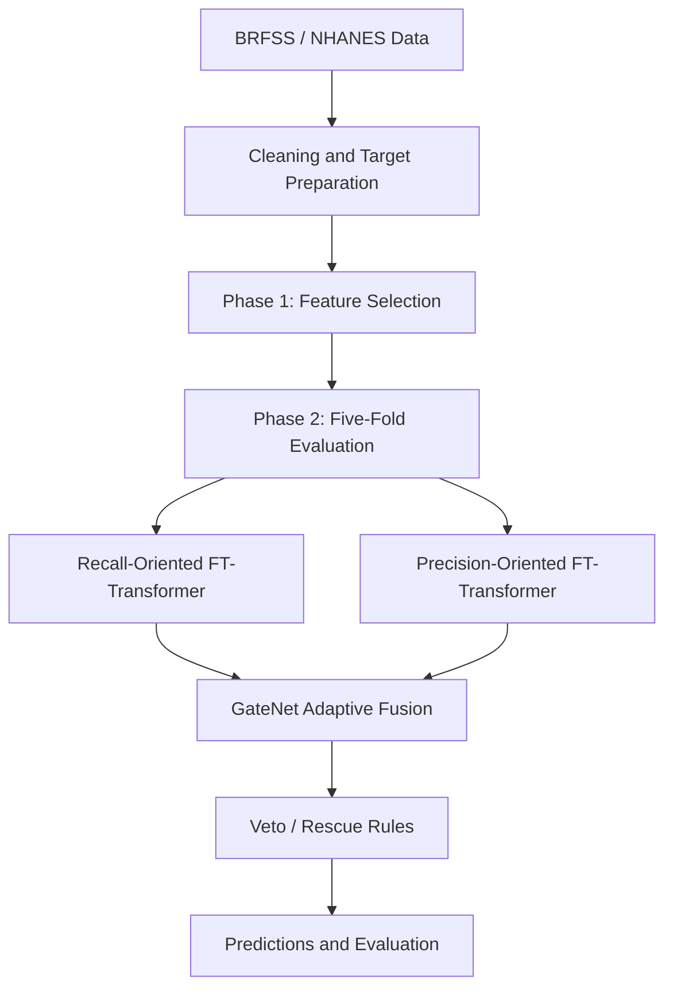

# Dual-Branch FT-Transformer
### Original Research Implementation and Reproducibility

This repository presents the original research implementation, experimental results, and supporting materials for the peer-reviewed study:

> **Leakage-Safe Precision-Aware Dual-Branch FT-Transformer for Population-Scale Heart Disease Risk Prediction**
>
> **Authors:** Jahidul Islam, Dristi Datta, and Fowzia Akhter
>
> **Published:** *Sensors*, 2026, 26(11), 3417
>
> **DOI:** https://doi.org/10.3390/s26113417

## Research Overview

Heart-disease risk prediction using population-scale health data is challenging because of class imbalance and the trade-off between identifying positive cases and limiting false-positive predictions.

This research develops a **precision-aware Dual-Branch FT-Transformer** combining:

1. **Recall-oriented learning** to prioritise positive-case detection.
2. **Precision-oriented learning** to control false-positive predictions.
3. **GateNet adaptive fusion** to combine branch probabilities, followed by veto/rescue decision rules.

The proposed approach was evaluated on **452,464 BRFSS 2024 respondents** and an independently trained **NHANES 2017–March 2020** evaluation pipeline involving **9,180 participants**. The study also examined 11 baseline models and supporting ablation, threshold, error-analysis, and calibration experiments.

This repository preserves the **original Python research scripts, experimental outputs, and methodology**. In November 2026, these existing materials were organised and the core experiments were rerun to verify reproducibility against the original saved results.

The project was initially developed under the working name *HeartSense*. The documentation now uses **Dual-Branch FT-Transformer** as the method's short name, while historical filenames and paths remain unchanged.

---

## Quick Navigation

| Resource | What to Explore |
| --- | --- |
| [`CODE_WALKTHROUGH.md`](CODE_WALKTHROUGH.md) | Detailed walkthrough of the original Python implementation |
| [`docs/METHOD.md`](docs/METHOD.md) | Feature selection, architecture, training, and evaluation procedures |
| [`original_code/`](original_code/) | 19 original research scripts |
| [`verified_outputs/`](verified_outputs/) | Model results, feature selections, ablations, and analysis outputs |
| [`REPRODUCIBILITY.md`](REPRODUCIBILITY.md) | Experimental reruns, output comparisons, and verification evidence |
| [`DATA.md`](DATA.md) | Dataset sources, preparation, and input requirements |
| [`CONTRIBUTION.md`](CONTRIBUTION.md) | Research contributions, implementation history, and attribution |

## 1. Research Methodology

### 1.1 Datasets and Feature Selection

| Dataset | Participants | Positive Prevalence | Selected Features |
| --- | ---: | ---: | ---: |
| BRFSS 2024 | 452,464 | 9.36% | 181 of 283 |
| NHANES 2017–March 2020 | 9,180 | ~9.53% | 141 of 163 |

BRFSS uses the self-reported coronary heart disease or myocardial infarction indicator (`_MICHD`) as the binary target.

The feature-selection pipeline combines **Pearson correlation, TabNet mask importance, and HistGradientBoosting permutation importance**.

Each selector operates within Phase-1 training folds. Selected features are fused within folds and then combined across five folds into the shared Phase-2 feature set.

**Validation detail:** Because the Phase-1 selections are united across folds before Phase-2 evaluation, the final feature set is not strictly independent of every Phase-2 outer validation fold. The exact procedure is documented in `docs/METHOD.md`.

### 1.2 Proposed Architecture



The implementation contains two separately trained FT-Transformer branches with complementary loss functions.

**Core architecture:**
- Learned 48-dimensional numerical feature tokens.
- Two pre-normalisation Transformer blocks with four attention heads.
- GELU feed-forward layers, dropout, mean pooling, and an MLP prediction head.
- Class-weighted binary cross-entropy for the recall branch.
- Adjusted positive weighting (`α = 1.3`) and negative-sample loss weighting (`4`) for the precision branch.

**GateNet** is a `3 → 16 → 1` MLP that combines branch predictions using:

`p = g × p_prec + (1 − g) × p_rec`

Its inputs are the precision probability, recall probability, and absolute disagreement between them.

The final decision mechanism applies:
- **Veto:** `p_prec < 0.20` → final probability set to 0.
- **Rescue:** `p_rec > 0.98` → final probability set to 1.
- **Decision threshold:** 0.50.

The implementation uses AdamW, mixed-precision training, inner-validation early stopping, and stratified five-fold evaluation.

Preprocessing includes removal of label-defining columns, training-fold-only imputation and scaling, and training-fold-only resampling where applicable.

Detailed architecture, loss functions, hyperparameters, and code references are provided in [`docs/METHOD.md`](docs/METHOD.md) and [`CODE_WALKTHROUGH.md`](CODE_WALKTHROUGH.md).

## 2. Experimental Results

The following results are from the original saved computational outputs, reproduced during the November 2026 verification.

### 2.1 BRFSS 2024: Baseline Comparison

**Evaluation:** Five-fold mean metrics, decision threshold 0.50.

**Source:** `verified_outputs/brfss/phase2_allmodels_allfeatures/master_results_phase2_allfeatures.csv`

| Model | Precision | Recall | F1 | ROC-AUC | AUPRC |
| --- | ---: | ---: | ---: | ---: | ---: |
| **Dual-Branch FT-Transformer** | 0.3359 | 0.5991 | **0.4294** | 0.8030 | 0.3659 |
| Random Forest | 0.3318 | 0.5768 | 0.4212 | 0.8494 | 0.3730 |
| Logistic Regression | 0.2453 | 0.7933 | 0.3747 | 0.8491 | 0.3799 |
| LSTM | 0.2491 | 0.7597 | 0.3722 | 0.8420 | 0.3606 |
| 1-D CNN | 0.2400 | 0.8108 | 0.3703 | 0.8505 | 0.3808 |
| GRU | 0.2287 | 0.7973 | 0.3550 | 0.8373 | 0.3487 |
| Autoencoder + LR | 0.2245 | 0.7337 | 0.3438 | 0.8087 | 0.2903 |
| Decision Tree | 0.2170 | 0.6577 | 0.3263 | 0.7600 | 0.2637 |
| Naive Bayes | 0.1862 | 0.7973 | 0.3019 | 0.7555 | 0.1925 |
| LightGBM | 0.5572 | 0.1313 | 0.2126 | 0.8526 | 0.3831 |
| Linear SVM | 0.5745 | 0.1144 | 0.1902 | 0.8483 | 0.3784 |
| KNN | 0.6147 | 0.0090 | 0.0178 | 0.7774 | 0.2802 |

The proposed model achieved the **highest five-fold mean F1-score** among the evaluated models at threshold 0.50. Other models achieved higher scores on certain individual metrics, including ROC-AUC and AUPRC.

The complete comparison, including accuracy and balanced accuracy, is available in the source CSV.

### 2.2 BRFSS: Pooled Evaluation and Ablation

**Pooled out-of-fold confusion matrix (452,464 respondents):**

| TN | FP | FN | TP | Pooled F1 |
| ---: | ---: | ---: | ---: | ---: |
| 359,639 | 50,487 | 16,975 | 25,363 | **0.4292** |

**Ablation comparison:**

| Configuration | Pooled F1 |
| --- | ---: |
| Recall branch only | 0.3781 |
| Precision branch only | 0.3750 |
| Simple branch average | **0.4310** |
| GateNet only | 0.4292 |
| GateNet + veto/rescue | 0.4292 |

The simple-average configuration produced a slightly higher pooled F1 than the final GateNet configuration. The final veto/rescue rules changed one BRFSS false-positive decision at threshold 0.50.

### 2.3 NHANES: Independent Cohort Evaluation

The NHANES pipeline uses separate cohort-specific preprocessing, feature selection, training, and evaluation rather than transferring BRFSS-trained model weights.

**Pooled out-of-fold results (9,180 participants):**

| TN | FP | FN | TP | Pooled F1 |
| ---: | ---: | ---: | ---: | ---: |
| 7,626 | 679 | 374 | 501 | **0.4876** |

| Prediction Output | AUROC | AUPRC |
| --- | ---: | ---: |
| Gate-only | 0.8736 | 0.4677 |
| Final veto/rescue output | 0.8062 | 0.4252 |

Gate-only and final NHANES outputs produced identical binary decisions at threshold 0.50, although their probability-ranking metrics differed.

### 2.4 Experimental Verification

The original research scripts were rerun and compared against saved research outputs. Core feature-selection results, model predictions, confusion matrices, baseline results, and available analyses were reproduced, including exact matches.

A separate comparison of 200 publication-reported numerical values identified 10 differences between printed manuscript values and saved experimental outputs. These are documented in [`REPRODUCIBILITY.md`](REPRODUCIBILITY.md), while the original code and results remain preserved.

## 3. Original Code and Reproducibility

### 3.1 Repository Organisation

| Location | Contents |
| --- | --- |
| `original_code/` | 19 original Python research scripts |
| `run_code/` | 14 path-adjusted execution copies |
| `verified_outputs/` | Verified experimental and analytical outputs |
| `evidence/` | Execution reports, logs, and source provenance |
| `env/` | Dependencies and environment specifications |
| `manifests/` | SHA-256 hashes and source-file mappings |
| `tools/` | Execution and verification utilities |

The original code was preserved with its computational logic intact. Personal Windows user-folder paths were sanitised for distribution, and execution copies contain documented environment-specific path adjustments.

### 3.2 Verified Environment

The November 2026 verification used:

- **OS:** Windows 11
- **Python:** 3.12.10
- **PyTorch:** 2.9.1 with CUDA 12.8
- **GPU:** NVIDIA RTX 5070 Ti Laptop GPU (12 GB)
- **Dependencies:** `env/requirements.txt`

These dependency versions describe the November verification environment. See `env/ENVIRONMENT.md` for details.

### 3.3 Dataset Preparation

Follow [`DATA.md`](DATA.md) to obtain the datasets.

Expected input locations:

- BRFSS: `data/brfss/main_data_brfss_2024.XPT`
- NHANES: 18 `P_*.xpt` files in `data/nhanes/`

The BRFSS file can alternatively be specified through `HS_BRFSS_XPT`.

Raw datasets are not distributed with the repository.

### 3.4 Execution Instructions

From the repository root, use PowerShell on a compatible Windows/NVIDIA environment:

```powershell
powershell -ExecutionPolicy Bypass -File .\00_setup_env.ps1
powershell -ExecutionPolicy Bypass -File .\00a_gpu_check.ps1
```

Run the experimental stages in order:

| Stage | Command | Recorded Runtime |
| --- | --- | --- |
| 1. NHANES | `.\01_stage1_nhanes.ps1` | ~3 min |
| 2. BRFSS feature selection and proposed model | `.\02_stage2_brfss_core.ps1` | ~185 min |
| 3. BRFSS baseline models | `.\03_stage3_brfss_baselines.ps1` | ~72 min |
| 4. BRFSS analyses | `.\04_stage4_brfss_analysis.ps1` | <1 min |

Stage scripts support `-CheckOnly` for prerequisite inspection without a full run.

The repository also provides Python stage-running and output-comparison utilities in `tools/`.

### 3.5 Verification Evidence

The core verification records are available in:

- [`REPRODUCIBILITY.md`](REPRODUCIBILITY.md)
- `evidence/reports/FINAL_REPRODUCIBILITY_REPORT.md`
- `evidence/manifests_verified_runs/`
- `evidence/package_build/verification.md`

Large BRFSS row-level prediction files are excluded from the repository but can be regenerated by the corresponding research stages. Excluded-file hashes are recorded in `manifests/excluded_files.sha256`.

Selected NHANES prediction-level outputs are included in the archived verification materials.

To check the integrity of the distributed package:

```powershell
python tools/verify_package.py
```

The latest reported verification passed for **223 manifest-listed files**, with zero integrity failures.

## 4. Research Contributions and Citation

The research was conducted by **Jahidul Islam, Dristi Datta, and Fowzia Akhter**.

Jahidul Islam initiated the research idea and led the practical implementation and experimental development, with academic supervision and methodological guidance from Dr Dristi Datta and Dr Fowzia Akhter.

For the detailed contribution map, development history, and attribution, see [`CONTRIBUTION.md`](CONTRIBUTION.md).

### Publication

Islam, J., Datta, D., & Akhter, F. (2026). Leakage-Safe Precision-Aware Dual-Branch FT-Transformer for Population-Scale Heart Disease Risk Prediction. *Sensors, 26*(11), 3417.

**DOI:** https://doi.org/10.3390/s26113417

### Repository Access

This repository is maintained as a private research copy for academic review. Redistribution of research materials or third-party resources is subject to applicable permissions and licensing requirements.

---

**Dual-Branch FT-Transformer — Original Research Implementation, Experimental Results, and Reproducibility**
